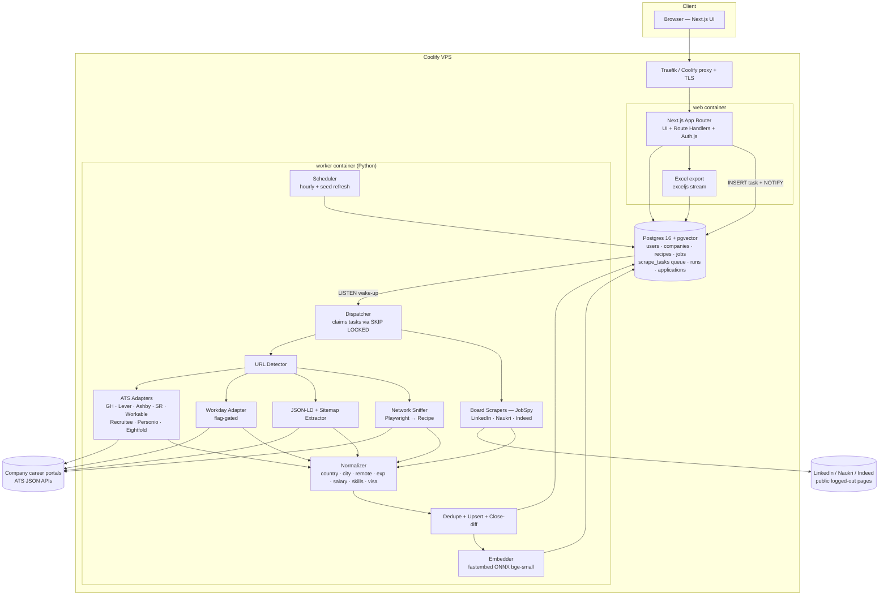
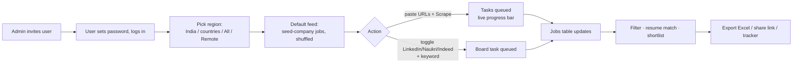
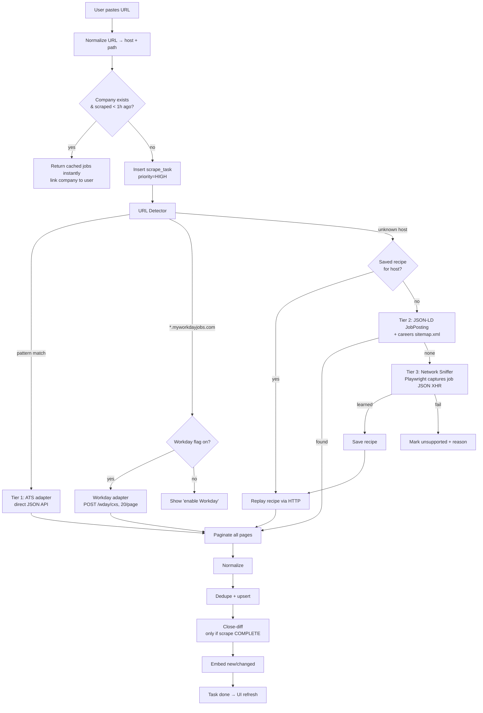

# JobScout — System Design & Architecture

Status: design draft v1 (2026-10-31). Name/domain TBD.

> **Build mode: LOCAL FIRST.** Everything runs on the dev Windows machine until the client approves.
> VPS/Coolify deployment is out of scope for now — sections mentioning it describe the *later* target only.
>
> Local setup: `docker compose up db` (Postgres 16 + pgvector) · `npm run dev` (Next.js, :3000) · `python -m worker` (Python worker). Same code moves to VPS unchanged later.

---

## 1. Requirements

### Functional
1. **Invite-only access.** Admin creates users / invite links. No public signup.
2. **Region selection.** User picks: `India` · specific countries (multi-select from full ISO list) · `All countries` · `Remote` (Remote-anywhere, Remote-India, Remote-in-country).
3. **Default feed.** Before user adds any URL, show a shuffled feed of jobs from an admin-managed seed list of popular companies (refreshed hourly), filtered by the chosen region.
4. **URL scrape (core feature).** User pastes 1..N careers URLs (box, multi-line, or CSV) → clicks **Scrape** → system scrapes *every* job from that portal → shows live progress → jobs appear in the table.
5. **Board toggles.** LinkedIn / Naukri / Indeed switches. Enabled board → scrape **only that board** for user's keyword + region. Boards need a search keyword (you can't pull "all of LinkedIn").
6. **Workday toggle** (separate feature flag, admin + user level).
7. **Filters:** country, city, remote/hybrid/on-site, employment type, experience level + years, posted date, company, source, department, salary range (INR/yr normalized), skills, visa-sponsorship, keyword.
8. **Excel export** of all rows matching current filters (or selected rows).
9. **Extras:** dedupe across sources, NEW/CLOSED badges, hourly auto-refresh of watched companies, resume match score (local embedding model), application tracker (kanban), shortlist share link, admin scraper-health dashboard, per-user daily scrape quota.
   - ~~Saved-search alerts~~ — dropped per user.

### Non-functional
| Target | Value |
|---|---|
| Cost | ₹0 extra — runs on existing Coolify VPS, free libs only, no paid APIs/LLMs/proxies |
| Freshness | Watched companies ≤ 1 h old |
| Search latency | p95 < 300 ms for filtered list (indexed Postgres) |
| Scrape feedback | Progress visible within 2 s of click |
| Availability | Single VPS, best-effort (~99%); daily DB backup |
| Legal posture | Logged-out only, no CAPTCHA bypass, rate-limited, honest UA, link back to source |

---

## 2. Capacity estimation (back-of-envelope)

Assumptions: 50–500 invited users, ~300 watched companies, 3 boards.

| Item | Math | Result |
|---|---|---|
| Active jobs | 300 companies × ~800 avg (Microsoft-size ~5k, startups ~30) + boards ~50k | **~300k active** |
| Job row size | ~3 KB desc + 0.5 KB fields + 1.5 KB vector (384 × float32) | ~5 KB |
| DB size | 300k × 5 KB + closed history ×2 | **~3 GB** |
| Hourly refresh fetches | ATS JSON: 1–N pages/company → ~1,500 req/h | ~0.4 req/s (trivial) |
| Workday | ~20 jobs/page → 5k-job tenant = 250 req; paced 1 req/s | ~4 min/tenant |
| Embeddings | only new/changed jobs, ~5–10k/h; MiniLM/bge-small ONNX on CPU ≈ 50–150 docs/s | 1–3 min/h CPU |
| Read QPS | 500 users × 50 actions/day / 86,400 | **<1 QPS avg, ~5 peak** |

**Conclusion:** single VPS is plenty. Bottleneck is headless Chrome RAM and anti-bot blocks, not DB or CPU.

RAM budget (worker + web + DB): Postgres 1 GB · Next.js 300 MB · worker 400 MB · 2× Chromium 800 MB · embed model 200 MB → **~3 GB**. Needs VPS with ≥ 4 GB free.

---

## 3. High-level architecture



**3 containers only:** `web` (Next.js), `worker` (Python), `db` (Postgres+pgvector). No Redis, no Kafka — Postgres is the queue (`FOR UPDATE SKIP LOCKED` + `LISTEN/NOTIFY`). Add Redis only if queue throughput ever matters (it won't at this scale).

---

## 4. Core flows

### 4.1 User journey



### 4.2 URL scrape pipeline (the main feature)



### 4.3 Board toggle pipeline

```
Toggle LinkedIn ON + keyword "data engineer" + region India
  → scrape_task(kind=board, board=linkedin, q, location, max_results=500)
  → board pool (concurrency 1 per board, 3–6 s jitter between pages)
  → JobSpy scrape_jobs(site_name=["linkedin"], search_term, location,
                       hours_old, linkedin_fetch_description=True)
  → Normalize → Dedupe (merges with same job from company portal) → upsert
  → UI shows ONLY source=linkedin rows while LinkedIn is the only toggle on
```

Toggles act as **source filters + scrape triggers**: enabling LinkedIn both queues a scrape and restricts the view to `source='linkedin'`. Multiple toggles = union.

### 4.4 Hourly refresh

```
every 5 min scheduler tick:
  enqueue company where
     last_scraped_at < now() - 1h
     AND (is_seed OR watched by a user active in last 7 days)
     AND status != 'unsupported'
  priority = LOW  (user clicks always jump the queue)
  stagger: spread across the hour by hash(company_id) % 60
```

---

## 5. Deep dives

### 5.1 URL Detector + adapter registry

One function, ordered regex table → adapter. Covers known ATS by URL shape; tenant slug extracted from URL.

| Pattern | Adapter | Endpoint |
|---|---|---|
| `boards.greenhouse.io/{t}` · `job-boards.greenhouse.io/{t}` · `?gh_jid=` | greenhouse | `GET boards-api.greenhouse.io/v1/boards/{t}/jobs?content=true` |
| `jobs.lever.co/{s}` | lever | `GET api.lever.co/v0/postings/{s}?mode=json&skip&limit` (EU: `api.eu.lever.co`) |
| `jobs.ashbyhq.com/{n}` | ashby | `GET api.ashbyhq.com/posting-api/job-board/{n}?includeCompensation=true` |
| `jobs.smartrecruiters.com/{c}` | smartrecruiters | `GET api.smartrecruiters.com/v1/companies/{c}/postings` (+detail) |
| `apply.workable.com/{x}` | workable | `GET apply.workable.com/api/v1/widget/accounts/{x}` |
| `{x}.recruitee.com` | recruitee | `GET {x}.recruitee.com/api/offers` |
| `{x}.jobs.personio.de` | personio | `GET {x}.jobs.personio.de/xml` |
| `{t}.wd{N}.myworkdayjobs.com/{site}` | workday (flag) | `POST {t}.wd{N}.myworkdayjobs.com/wday/cxs/{t}/{site}/jobs` `{limit:20,offset,appliedFacets}` + detail GET |
| `*.eightfold.ai` · `careers.microsoft.com` · `apply.careers.microsoft.com` | eightfold | Eightfold `/api/apply/v2/jobs?domain=…&start&num` (verify per tenant; falls to sniffer if shape differs) |
| anything else | generic | Tier 2 → Tier 3 |

If a pasted URL is a company homepage/careers landing page that *links* to an ATS (e.g. `acme.com/careers` iframes Greenhouse), the detector fetches the page once and scans HTML/iframes/scripts for ATS URLs before falling to Tier 2.

Adding a new ATS = one file implementing:
```python
async def fetch_all(company, region) -> AsyncIterator[RawJob]
```

### 5.2 Network Sniffer + Recipes (how arbitrary portals like Microsoft get scraped for free)

1. Open URL in Playwright (pool of 2 Chromium contexts, blocks images/fonts/media).
2. Record every `fetch/XHR` response with `content-type: json`.
3. Score each response: array length ≥ 5 AND objects contain title-like key (`title|name|jobTitle|position`) AND location/URL/id-like keys.
4. Best candidate → derive **recipe**: method, URL template, headers needed, body, which param is the page/offset (diff two consecutive calls by scrolling/clicking "next"/"load more"), and JSON path → field map.
5. Validate recipe by replaying page 2 with plain `httpx`/`curl_cffi` (no browser). If it works → save to `recipes` table keyed by host. Future scrapes = cheap HTTP only.
6. If replay fails (token/cookie bound) → keep browser mode for that host (slower, still works).
7. Recipe breaks later (schema change / 4xx) → auto re-learn once, then mark `needs_attention` on admin dashboard.

Field map is heuristic (key-name matching) — admin can hand-edit a recipe JSON in the dashboard when a site is mapped wrong.

### 5.3 Normalizer (rules, no LLM — free)

| Field | Method |
|---|---|
| country / city | ATS structured location first → else parse `location_raw` with a GeoNames cities table (`cities15000`, free, ~25k cities) + country name/ISO aliases. India cities alias map (Bangalore→Bengaluru, Gurgaon→Gurugram…). |
| remote / hybrid / on-site | ATS flags (`workplaceType`, `isRemote`) → else regex on location+title+desc (`remote`, `work from home`, `hybrid`, `wfh`). Remote scope: `Remote - India`, `Remote (US)`, `Anywhere`. |
| employment type | ATS field → else regex (full-time / part-time / intern / contract / temp / apprentice). |
| experience | regex `(\d+)\s*(\+|-|to)\s*(\d+)?\s*(years|yrs)` on desc; title cues (intern, junior, senior, staff, lead, principal) → `exp_level` bucket. |
| salary | ATS compensation fields → else regex with currency symbols/codes + period (hour/month/year, LPA/lakh/CTC) → `salary_inr_year` using a daily FX table (free ECB/Frankfurter rates). |
| skills | dictionary of ~500 skills with regex word boundaries → `text[]`. |
| visa sponsorship | phrases: "visa sponsorship", "sponsor", "relocation support", "will not sponsor" (negative). |
| posted_at | ATS date → else `first_seen_at`. |

### 5.4 Dedupe & close-diff

- **Within a source:** `UNIQUE(source, external_id)` → upsert. `external_id` = ATS job id or canonical URL hash.
- **Across sources** (same job on Microsoft portal + LinkedIn + Naukri): `dedupe_key = sha1(norm(company) | norm(title) | country | city)` → same key within 30 days ⇒ same `cluster_id`. Phase 2 add MinHash on description for fuzzy matches.
- UI lists **one row per cluster**, preferring the company-portal row (source of truth), with badges for every source it appears on.
- **Close-diff:** after a *fully successful* company scrape, jobs of that company not seen in this run → `status='closed'`, `closed_at=now()`. Partial/failed scrape ⇒ **never** close (prevents wiping jobs on a network blip). Board rows close when `last_seen_at` > 7 days (boards are search-based, absence ≠ closed).

### 5.5 Resume match (embedding — yes, works on CPU, free)

- Model: `BAAI/bge-small-en-v1.5` (384-dim, ~130 MB) via **fastembed** (ONNX runtime, no PyTorch, CPU-only). Alt: `all-MiniLM-L6-v2`.
- Embed `title + skills + first 512 tokens of description` only for new/changed jobs → `jobs.embedding vector(384)`, HNSW index (pgvector).
- User uploads resume (PDF/DOCX → text via `pypdf`/`python-docx`, in worker) → one embedding stored in `resumes`.
- Match score = `0.7 × cosine(resume, job) + 0.3 × skill-overlap ratio` → shown as %, sortable. Pure cosine is noisy; skill overlap makes it explainable ("matches: Python, AWS, SQL · missing: Kafka").
- Cost: CPU minutes per hour. Quality: good for ranking, not a hiring decision — label as "match estimate".

### 5.6 Region & remote filtering semantics

| User choice | SQL predicate |
|---|---|
| India | `country_code='IN' OR (is_remote AND remote_scope IN ('IN','ANY'))` |
| Specific countries [US, DE] | `country_code = ANY($1) OR (is_remote AND remote_scope = ANY($1 ∪ 'ANY'))` |
| All countries | no predicate |
| Remote | `is_remote` + optional scope (Anywhere / India / chosen country) |

Region also passed *into* scrapers where supported (Workday location facets, board `location` param) to cut fetch volume.

---

## 6. API design (FastAPI — Python backend; Next.js frontend consumes it)

> Change from v1: API moved from Next.js route handlers to **FastAPI** in the same Python codebase as the worker, so the backend is complete and testable before any frontend exists. Auth = JWT in httpOnly cookie. Excel = openpyxl write-only mode. Progress = SSE from FastAPI.

| Method | Path | Body / Params | Returns |
|---|---|---|---|
| POST | `/api/auth/*` | Auth.js credentials | session |
| POST | `/api/admin/invites` | `{email, role}` | invite link (copy/paste — no SMTP cost) |
| GET/PATCH | `/api/admin/users/:id` | `{active, daily_quota, role}` | user |
| GET/PATCH | `/api/admin/flags` | `{workday, linkedin, naukri, indeed}` | flags |
| GET | `/api/admin/health` | — | per-adapter success %, blocked count, last run, recipes needing attention |
| PUT | `/api/me/prefs` | `{region_mode, countries[], remote_scope, boards{}}` | prefs |
| POST | `/api/scrape/urls` | `{urls: string[]}` (1..50) | `[{task_id, company_id, detected_ats, cached}]` |
| POST | `/api/scrape/boards` | `{boards:['linkedin'], q, location, hours_old}` | `[{task_id}]` |
| GET | `/api/scrape/tasks/:id/stream` | SSE | `{status, progress, found, new, closed, error}` |
| GET | `/api/jobs` | filters + `cursor`, `limit≤100`, `sort` (`posted`/`match`/`salary`) | `{items, next_cursor, total_estimate}` |
| GET | `/api/jobs/facets` | same filters | counts per country/source/company/exp… |
| GET | `/api/jobs/export.xlsx` | same filters or `ids[]` | streamed .xlsx (cap 50k rows) |
| GET | `/api/feed/default` | region | shuffled seed jobs |
| POST | `/api/resume` | multipart file | `{resume_id}` (embedded async) |
| CRUD | `/api/applications` | `{job_id, stage, notes}` | tracker items |
| POST | `/api/shortlists` | `{job_ids[]}` | share token URL (read-only, expiring) |

Rate limits: per-user daily scrape quota (default 30 URL scrapes + 10 board scrapes) enforced in `/api/scrape/*`.

---

## 7. Data model (Postgres 16 + pgvector)

```sql
users(id, email UNIQUE, password_hash, role CHECK(role IN ('admin','user')),
      active bool, daily_quota int, created_at)
invites(token PK, email, role, created_by, expires_at, used_at)
user_prefs(user_id PK, region_mode, countries text[], remote_scope,
           boards jsonb)                         -- {"linkedin":true,...}
feature_flags(key PK, enabled bool)              -- workday, linkedin, naukri, indeed

companies(id, name, host, careers_url, ats_type, ats_slug, ats_extra jsonb,
          is_seed bool, status CHECK(status IN ('ok','error','unsupported','needs_attention')),
          last_scraped_at, last_error, job_count, UNIQUE(ats_type, ats_slug))
user_companies(user_id, company_id, added_at, PRIMARY KEY(user_id, company_id))

recipes(host PK, mode CHECK(mode IN ('http','browser')), request jsonb,
        pagination jsonb, field_map jsonb, verified_at, fail_count)

scrape_tasks(id, kind CHECK(kind IN ('company','board','resume')), payload jsonb,
             user_id NULL, priority smallint, status CHECK(status IN
             ('queued','running','done','error')), attempts, run_after,
             locked_at, progress jsonb, error, created_at)
  INDEX (status, priority DESC, run_after)       -- dispatcher claim

jobs(id, source, external_id, company_id NULL, company_name, url, apply_url,
     title, department, description, location_raw,
     country_code char(2), city, is_remote bool, remote_scope, work_arrangement,
     employment_type, exp_min, exp_max, exp_level,
     salary_min, salary_max, salary_currency, salary_period, salary_inr_year,
     skills text[], visa_sponsorship bool,
     posted_at, first_seen_at, last_seen_at, status ('active'|'closed'), closed_at,
     content_hash, dedupe_key, cluster_id,
     embedding vector(384),
     search tsvector GENERATED ALWAYS AS (to_tsvector('simple', title||' '||coalesce(company_name,''))) STORED,
     UNIQUE(source, external_id))
  INDEXes: (status, country_code, posted_at DESC), (company_id, status),
           GIN(skills), GIN(search), (cluster_id), HNSW(embedding vector_cosine_ops)

scrape_runs(id, task_id, company_id, adapter, started_at, finished_at,
            fetched, inserted, updated, closed, http_errors, blocked bool, error)
resumes(id, user_id, filename, text, skills text[], embedding vector(384), created_at)
applications(id, user_id, job_id, stage, notes, updated_at, UNIQUE(user_id, job_id))
shortlists(token PK, user_id, job_ids bigint[], expires_at)
fx_rates(currency PK, inr_rate, fetched_at)
```

Jobs are **shared** across users (scraped once, everyone benefits). `user_companies` decides what each user sees under "My companies"; default feed uses `is_seed`.

---

## 8. Tech stack

| Layer | Choice | Why |
|---|---|---|
| Web | Next.js 15 (App Router) + Tailwind + shadcn/ui + TanStack Table | You already ship Next.js; server-side filters + streaming export |
| Auth | Auth.js credentials + invite tokens | Invite-only, no OAuth needed |
| DB | Postgres 16 + pgvector | One store for data, queue, search, vectors |
| ORM | Drizzle (web) · psycopg 3 / SQLAlchemy core (worker) | Thin, SQL-first |
| Worker | Python 3.12, asyncio | Scraping ecosystem is Python |
| HTTP | httpx + curl_cffi (browser TLS fingerprint for picky hosts) | Free, fast |
| Browser | Playwright Chromium (pool = 2) | Sniffer + JS-only portals |
| Boards | python-jobspy | Maintained; LinkedIn/Indeed/Naukri support |
| Extraction | extruct (JSON-LD), selectolax | Free, fast |
| Embeddings | fastembed + bge-small-en-v1.5 | CPU ONNX, no GPU, no API cost |
| Excel | exceljs (streaming writer) | Large exports without RAM spike |
| Deploy | Coolify docker-compose (3 services) + nightly `pg_dump` | Existing infra |

---

## 9. Worker internals

```
worker/
  main.py            # starts scheduler + dispatcher loops
  queue.py           # claim(): UPDATE … WHERE id = (SELECT … FOR UPDATE SKIP LOCKED LIMIT 1)
  detect.py          # URL → (ats_type, slug, extra)
  adapters/          # greenhouse.py lever.py ashby.py smartrecruiters.py workable.py
                     # recruitee.py personio.py workday.py eightfold.py jsonld.py
  sniffer/           # playwright_capture.py recipe_learn.py recipe_replay.py
  boards/            # jobspy_runner.py  (linkedin | naukri | indeed)
  normalize/         # geo.py remote.py exp.py salary.py skills.py visa.py
  store.py           # upsert, dedupe cluster, close-diff
  embed.py           # fastembed batch embed
  data/              # cities15000.tsv, skills.txt, country_aliases.json
```

Concurrency pools (semaphores): `http=16`, `browser=2`, `board=1 per board`, `workday=2 tenants`. Per-host politeness: ≥1 s between requests to same host (Lever 1 s, Workable ~0.7 s, boards 3–6 s jittered). Retries: 3 with exponential backoff; HTTP 403/429/CAPTCHA page ⇒ mark `blocked`, stop that host for 30 min — **never** attempt CAPTCHA bypass.

---

## 10. Trade-offs

| Decision | Chosen | Alternative | Why |
|---|---|---|---|
| Queue | Postgres SKIP LOCKED | Redis/RQ, Celery | One less container; <1 task/s load |
| Search | Postgres indexes + tsvector | Meilisearch/Typesense | 300k rows fine in PG; add Meili only if facets get slow |
| Extraction | Rules + recipes | LLM extraction | Budget = free; ATS JSON is already structured |
| Unknown portals | Network sniffer → recipe | Hand-written adapters per site | Scales to any site without code per company |
| Boards | JobSpy logged-out | Apify/Bright Data | Free; accepts block risk |
| Jobs scope | Shared global table | Per-user copies | Scrape once, everyone benefits, less load |
| Dedupe v1 | Exact key on company+title+city | MinHash/embeddings | Simple first; fuzzy in phase 2 |
| Embedding | Local bge-small | OpenAI embeddings | Free, private; small quality gap OK for ranking |

---

## 11. Scaling path

| Stage | Users / jobs | Change |
|---|---|---|
| v1 | ≤500 users / ≤500k jobs | As designed, single VPS |
| v2 | ~5k users / ~2M jobs | Meilisearch for facets; separate worker VPS; partition `jobs` by status; Redis for SSE fan-out |
| v3 | 50k+ users / 10M+ jobs | Kafka/SQS, worker autoscaling, OpenSearch, residential proxies for boards (paid), object storage for raw pages |

---

## 12. Failure modes & mitigation

| Failure | Impact | Mitigation |
|---|---|---|
| LinkedIn/Naukri/Indeed blocks VPS IP | Board results empty | Detect 429/403/auth-wall → mark blocked, back off 30 min, show "source temporarily unavailable" badge; company-portal data unaffected |
| Partial scrape (timeout mid-pagination) | Jobs wrongly closed | Close-diff runs only on `complete=True` runs |
| Recipe breaks (site redesign) | Company returns 0 jobs | 0-jobs-when-previously-N anomaly → re-learn once → `needs_attention` on dashboard |
| Workday Cloudflare / 400 on page size >20 | Slow/failing tenant | limit=20, 1 req/s, curl_cffi; flag-gated so failures isolate |
| Chromium memory leak | Worker OOM | Recycle browser every 50 pages; container mem limit + Coolify auto-restart |
| User pastes 500 URLs | Queue flood | 50 URLs/request cap + daily quota + priority fairness (round-robin per user) |
| Malicious URL (SSRF: `http://169.254.…`, `localhost`) | Internal network access | Resolve host, block private/loopback/link-local IPs, http(s) only, max redirects 5 |
| DB loss | Everything | Nightly `pg_dump` to off-VPS storage (free B2/R2 tier) |
| Duplicate floods (repost spam) | Noisy list | cluster_id collapse + "reposted N times" badge |
| Legal takedown request | Compliance | `suppressed_hosts` list; remove + stop scraping within 24 h |

---

## 13. Build phases

| # | Scope | Done when |
|---|---|---|
| 1 | Repo + compose, DB schema, Auth (invite-only), region picker, URL box, detector + Greenhouse/Lever/Ashby/SR/Workable/Recruitee/Personio, normalizer v1, jobs table + filters, Excel export, default seed feed | Paste a Greenhouse URL → jobs in table + Excel |
| 2 | Workday (flag), Eightfold (Microsoft), JSON-LD, network sniffer + recipes | Microsoft careers URL returns all jobs |
| 3 | LinkedIn/Naukri/Indeed toggles (JobSpy), cross-source dedupe | Each toggle returns only its board |
| 4 | Hourly scheduler, NEW/CLOSED badges, admin health dashboard, quotas | Watchlist self-refreshes |
| 5 | Resume match (fastembed + pgvector), application tracker, shortlist share | Match % visible, tracker works |
| 6 | Local QA pass + client demo | Client approves |
| later | Coolify deploy, backups (after approval) | Live on domain |

## 14. Open items
- App name.
- UI/UX design (user to describe next).
- Local: Docker Desktop for Postgres (or native Postgres + pgvector install).
- Deferred until client approval: domain, VPS RAM check, deploy.
- Seed company list for default feed (I'll propose ~50 across India + global).
